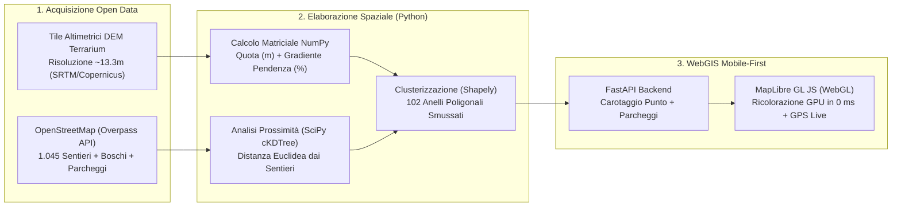

# Mappa Strategica Castagne — Analisi Geospaziale Campo dei Fiori (VA)

[](https://www.python.org/)
[](https://fastapi.tiangolo.com/)
[](https://shapely.readthedocs.io/)
[](https://maplibre.org/)
[](https://www.openstreetmap.org/)
[](./LICENSE)

Applicazione **WebGIS mobile-first** progettata per individuare le porzioni di castagneto più vocate, sicure a piedi e meno battute sul **Massiccio del Campo dei Fiori e Sacro Monte di Varese** (Parco Regionale Campo dei Fiori, Lombardia).

---

## Il Problema e L'Intuizione Progettuale

Durante la stagione autunnale, i raccoglitori occasionali di castagne (*Castanea sativa*) concentrano la ricerca quasi esclusivamente nei primi **30–45 metri** a ridosso dei sentieri escursionistici principali. Spingersi casualmente fuori sentiero in ambiente prealpino presenta però due ostacoli:
1. Non tutti i boschi ospitano il castagno (oltre gli 850–900 m s.l.m. prevalgono faggete pure o rimboschimenti di conifere).
2. Allontanarsi dal tracciato senza conoscere la morfologia del versante espone al rischio di imbattersi in salti di roccia o pendenze eccessive (> 35–40%).

### La Soluzione Tecnologica
Invece di ricorrere a complessi modelli di computer vision satellitare, il progetto incrocia **Open Data geografici vettoriali e altimetrici** per calcolare una **mappa strategica a 3 fasce di colore**, progettata per essere consultata con una sola mano sullo smartphone mentre si cammina sul sentiero:

| Fascia Cromatica | Distanza dal Sentiero (Configurabile) | Significato Operativo |
| :--- | :--- | :--- |
| **Gialla** | `0 – 45 m` *(default)* | **Fascia di Bordo Sentiero**: terreno comodo ma ad altissima pressione antropica (già battuto dai passanti). |
| **Arancione** | `45 – 110 m` *(default)* | **Fascia Strategica Consigliata**: fuori dalla vista diretta del sentiero, su pendenza dolce/camminabile, con rientro rapido e sicuro. |
| **Rossa** | `110 – 220 m` *(default)* | **Bosco Profondo**: aree di castagneto più interne e isolate, sempre filtrate per garantire una pendenza praticabile a piedi. |

> **Filtro di Sicurezza Automatico (DEM Slope)**: tutti i versanti con pendenza superiore alla soglia di sicurezza scelta dall'utente (es. `22%` Solo Pianori, `32%` Normale, `42%` Esperti) vengono automaticamente esclusi dalle fasce colorate.

---

## Architettura e Pipeline dei Dati



### Dettagli Tecnici Principali
- **Pipeline Geospaziale Offline/On-Demand (`scripts/fetch_and_process_gis.py`)**:
  - Scarica ed elabora una griglia DEM di `641 × 468` punti (quote da `271 m` a `1.212 m s.l.m.`) calcolando le derivate parziali $\frac{\partial Z}{\partial x}, \frac{\partial Z}{\partial y}$ per ottenere la pendenza percentuale esatta di ogni versante.
  - Analizza **24.451 celle boschive** (passo `42 m × 42 m`, pari a oltre `4.300 ettari` di superficie forestale) isolando i **20.123 quadranti** vocati a castagneto submontano (`340 – 880 m s.l.m.`).
  - Pre-aggrega geometricamente gli anelli di distanza e pendenza tramite `Shapely` (`unary_union` su segmenti di riga contigui + buffering morfologico), riducendo la geometria a **102 poligoni vettoriali leggeri**.
- **Rendering GPU a Latenza Zero (`static/app.js`)**:
  - Lo spostamento dello slider *"Distanza dal sentiero"* e il cambio della pendenza massima aggiornano le espressioni `step` e `filter` di **MapLibre GL JS** direttamente sulla GPU del telefono a **60 FPS (0 ms di attesa)**.
- **Resilienza Offline in Montagna**:
  - Se durante l'escursione nel bosco viene a mancare la copertura 4G/5G, l'applicazione attiva automaticamente un **motore di fallback locale lato client** che interroga le geometrie già in memoria per continuare a fornire distanze, pendenze e indicazioni sui parcheggi anche senza connessione.
- **Diario Personale Geolocalizzato (`localStorage`)**:
  - Pulsante rapido **"+ Segna posto"** per salvare con un tocco le coordinate GPS dei migliori alberi trovati, con persistenza locale sul dispositivo e copia rapida delle coordinate per Google Maps.

---

## Struttura del Repository

```text
foraging-castagne/
├── app.py                           # Server FastAPI + Endpoint API (/api/map-data, /api/spot-info)
├── gis_engine.py                    # Motore geospaziale Python (NumPy + Shapely)
├── requirements.txt                 # Dipendenze Python ottimizzate per il deploy serverless
├── vercel.json                      # Configurazione per il deploy automatico su Vercel
├── LICENSE                          # Licenza Open Source MIT
├── scripts/
│   └── fetch_and_process_gis.py     # Script ETL per scaricare e ricalcolare dati OSM e DEM
├── data/                            # Dataset geospaziali pre-elaborati sul Campo dei Fiori
│   ├── chestnut_rings.geojson       # Anelli poligonali distanza/pendenza dei castagneti
│   ├── trails.geojson               # Rete sentieristica classificata (CAI / Mulattiere / Tracce)
│   ├── landmarks.geojson            # Vette, località e parcheggi escursionistici
│   ├── spatial_grid.json            # Griglia metrica delle celle boschive (passo 42m)
│   └── dem_campodeifiori.npz        # Matrice altimetrica e clinometrica compressa
└── static/
    ├── index.html                   # Interfaccia Mobile-First + PWA meta tags
    ├── styles.css                   # Design System Outdoor ad alto contrasto per luce diurna
    ├── app.js                       # Logica WebGL, GPS live, salvagente offline e posti salvati
    └── manifest.json                # Web App Manifest per installazione su schermata Home
```

---

## Avvio Rapido in Locale

### 1. Clona il repository e installa le dipendenze
```bash
git clone https://github.com/fedenebu/foraging-castagne.git
cd foraging-castagne
pip install -r requirements.txt
```

### 2. Avvia il server FastAPI
```bash
python app.py
```
L'applicazione sarà immediatamente disponibile su **http://127.0.0.1:8000**.

### 3. Aggiornamento dei dati OpenStreetMap / DEM (Opzionale)
I dati elaborati per il Massiccio del Campo dei Fiori sono già inclusi in `data/`. Per rigenerarli interrogando da zero le API Overpass e i server altimetrici:
```bash
pip install scipy pillow
python scripts/fetch_and_process_gis.py --refresh
```

---

## Licenza

Distribuito sotto licenza **MIT**. Consulta il file [LICENSE](./LICENSE) per maggiori dettagli.
Dati cartografici: © [OpenStreetMap contributors](https://www.openstreetmap.org/copyright) (ODbL) · Dati altimetrici: Registry of Open Data on AWS / Copernicus DEM.
